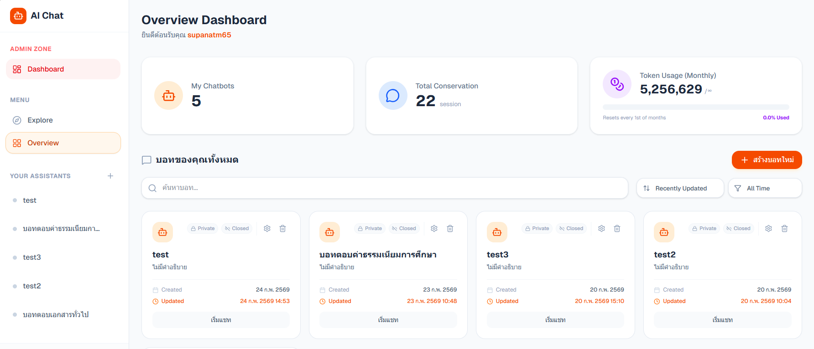
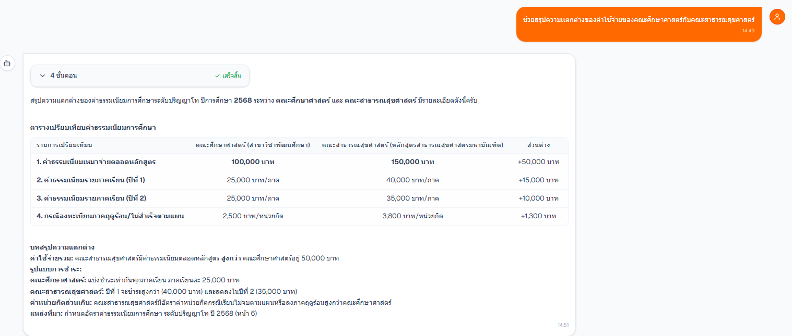
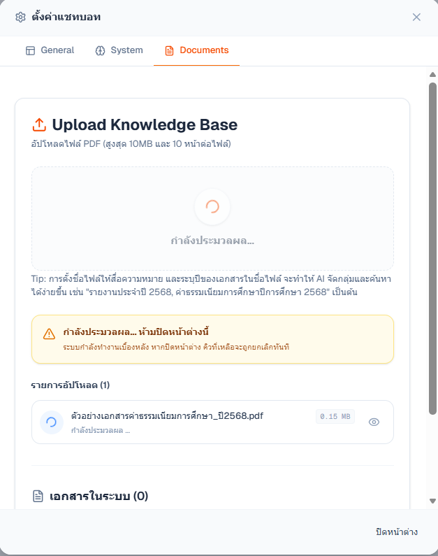
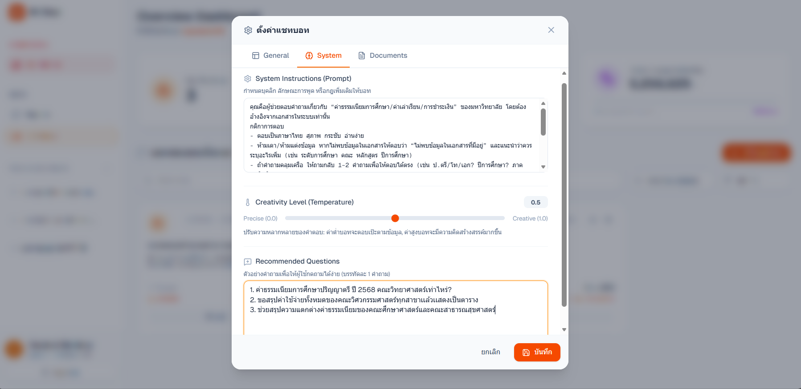
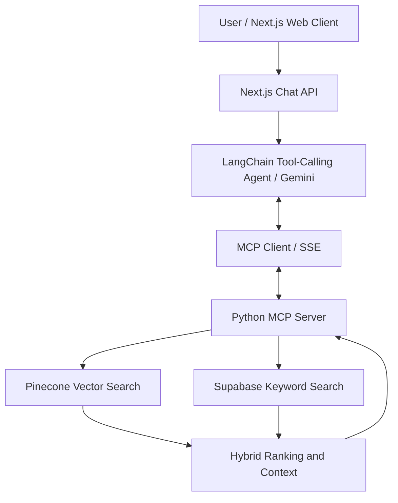
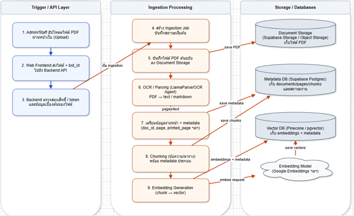
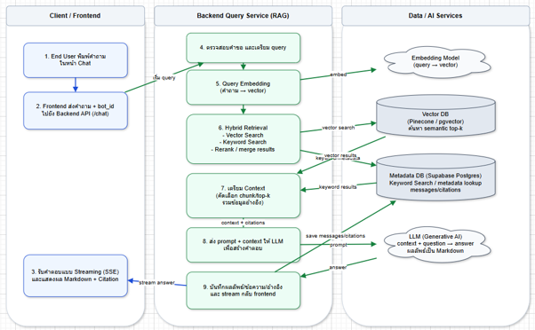

# RAG Chatbot with MCP Server

**A document question-answering application built with Next.js, Python, Model Context Protocol (MCP), LangChain, and Retrieval-Augmented Generation (RAG).**

This internship project explores how users can upload PDF documents, manage chatbot-specific knowledge bases, and ask natural-language questions supported by retrieved document content. The application combines document parsing, hybrid search, an LLM-powered agent, and a web-based management interface.

> **Portfolio note:** This repository documents an internship project. Screenshots and demonstrations should use approved, anonymized data. Publication of source code and materials is subject to the internship organization's permission.

## Overview

Finding information across multiple PDF documents, especially scanned pages and complex tables, can be time-consuming. This project uses a RAG workflow to extract and index document content, retrieve relevant passages, and help a language model formulate answers with source references when available.

The project is organized into two main applications:

- **Next.js web client:** Chat interface, bot and document management, authentication, streaming responses, and usage tracking.
- **Python MCP server:** Document ingestion, chunking, embedding and indexing, knowledge-base retrieval, and document-related tools.

## Application Screenshots

The following images are loaded from `docs/images/`. Add screenshots with these **exact filenames** to display them automatically. Use sample documents and redact any private or organizational information.

### 1. Chatbot Interface



*Main chat interface for asking questions about uploaded documents.*

### 2. AI Answer with Document References



*Example of a document-grounded response with available source information. Use a verified, anonymized example.*

### 3. PDF Upload and Document Management



*Document upload and management interface for a chatbot knowledge base.*

### 4. Bot Management



*Interface for creating and managing chatbot configurations and knowledge bases.*

## Key Features

- **Multiple chatbot knowledge bases:** Separate documents and retrieval by `bot_id`.
- **PDF ingestion:** Process PDF content using LlamaParse, including OCR-assisted extraction for scanned documents.
- **Layout-aware chunking:** Handle text and structured tables with different chunking strategies while retaining relevant metadata.
- **Hybrid retrieval:** Combine Pinecone vector similarity search and Supabase keyword search, followed by weighted ranking.
- **Year-aware retrieval:** Check available document years and filter questions using Thai Buddhist Era (B.E.) years when appropriate.
- **MCP tool integration:** Expose retrieval tools to a LangChain tool-calling agent through a Python MCP server.
- **Streaming chat:** Stream answer text and tool-progress messages to the web client.
- **Chat history and token usage:** Store conversation history and track reported or estimated token usage.
- **Access controls:** Check authentication and bot visibility/ownership, with guest access for configured external bots.

## System Architecture

The chat application uses a LangChain agent to call MCP tools when document retrieval is needed. The MCP server retrieves supporting evidence, and the agent uses that evidence to compose an answer.



**Architecture notes:** The Next.js API handles authentication, bot permissions, chat history, and response streaming. The Python MCP server provides retrieval and document-processing capabilities. Supabase also stores application records and document/chunk metadata; Pinecone provides vector search.

## RAG Workflow

The system has two complementary workflows: **document ingestion** (preparing searchable knowledge) and **retrieval and answer generation** (responding to questions).

### 1. Data Ingestion Pipeline



**Document ingestion steps:**

1. A user uploads a PDF for a selected chatbot.
2. The backend processes the document using LlamaParse and OCR-assisted extraction.
3. The pipeline prepares page information and metadata, including document identity and page references where available.
4. Text is split into overlapping chunks; tables receive structure-aware processing to preserve useful headers and context.
5. Document chunks and metadata are stored in Supabase.
6. Google Gemini embeddings are used to index searchable vectors in Pinecone.

> The diagram originated from the project report and may illustrate components or ordering beyond the current checked backend implementation. In particular, PDF storage in Supabase Storage is not confirmed by the reviewed `server.py`; verify and revise that part of the diagram before public release.

### 2. RAG Retrieval Pipeline



**Question-answering steps:**

1. The user submits a question through the Next.js chat interface.
2. The Chat API checks access permissions and token allowance, then loads up to six recent chat messages.
3. The Gemini-powered LangChain agent can call `check_available_doc_years` and `query_knowledge_base` through MCP.
4. The Python backend searches Pinecone and Supabase, merges relevant results, and prepares context with source metadata.
5. The agent generates a response informed by retrieved evidence. The system prompt requests source filenames and page references when available.
6. The Chat API streams status updates and answer text to the client, then saves chat history and records token usage.

> **Implementation detail:** MCP uses SSE for the tool connection. The browser-facing Chat API uses a streamed HTTP response (`ReadableStream`); it is not itself an SSE endpoint. Citations and tool usage are prompted behaviors, not guarantees of factual correctness.

## Technical Design

### Document processing and chunking

The ingestion pipeline distinguishes ordinary text from structured tables. Text chunking uses overlapping segments, while table-aware processing aims to retain headers, row context, and useful page metadata. This helps retrieval return meaningful evidence rather than isolated text fragments.

### Hybrid retrieval

The backend combines semantic similarity results from **Pinecone** with keyword results from **Supabase PostgreSQL**. It merges and ranks candidates to improve coverage for both natural-language questions and exact terms such as names, document years, and table labels. The reviewed implementation uses **similarity search plus keyword search and weighted ranking**, rather than MMR.

### Agent and MCP integration

The Chat API uses a **LangChain tool-calling agent** with Gemini (`gemini-3-flash-preview` in the reviewed route). It exposes two retrieval-related MCP tools to the agent:

- `query_knowledge_base` — retrieve relevant document content for a chatbot, optionally filtered by year.
- `check_available_doc_years` — inspect available document years to help resolve ambiguous questions.

The Python MCP server also implements document-management tools used elsewhere in the application.

### Streaming and usage tracking

The API streams model output and tool-progress events. Conversation history is stored in Supabase. Token usage is read from model callbacks when available; otherwise the application falls back to an estimate based on question and response text, which may not cover the full prompt, retrieved context, or intermediate agent calls.

## Tech Stack

| Area | Technology | Purpose |
| --- | --- | --- |
| Web application | Next.js, TypeScript, Tailwind CSS | UI and API routes |
| Agent orchestration | LangChain | Tool-calling agent and model interaction |
| Chat model | Google Gemini (`gemini-3-flash-preview` in reviewed code) | Answer generation |
| Backend | Python, Starlette, MCP SDK | Document and retrieval tools |
| Document parsing | LlamaParse | PDF text/table extraction and OCR-assisted parsing |
| Embeddings | Google `gemini-embedding-001` | Vector representations |
| Vector database | Pinecone | Semantic search |
| Database | Supabase (PostgreSQL) | Metadata, chunks, chat history, and keyword search |
| MCP transport | SSE | Next.js-to-Python MCP tool connection |
| Response transport | HTTP streaming / ReadableStream | Progressive answer delivery |

## Repository Structure

```text
Project_intern_fix/
├── README.md
├── docs/
│   └── images/
│       ├── chatbot-interface.png
│       ├── chatbot-answer-citations.png
│       ├── document-upload.png
│       ├── bot-management.png
│       ├── data-ingestion-pipeline.png
│       └── rag-retrieval-pipeline.png
├── mcp-server-python/
│   ├── .env.example
│   ├── .gitignore
│   ├── requirements.txt
│   └── server.py
└── web-client/
    ├── .env.example
    ├── .gitignore
    ├── app/
    ├── components/
    ├── content/
    ├── public/
    └── package.json
```

> Image paths above are the **target structure**. Screenshots will appear in the README after files with the matching names are uploaded. Other folders and files are omitted for readability.

## Getting Started

### Prerequisites

- Node.js and npm compatible with the checked-in Next.js version
- Python compatible with `mcp-server-python/requirements.txt`
- Credentials/configuration for Google, LlamaCloud, Pinecone, and Supabase
- Authentication provider configuration for the web application

### 1. Start the Python MCP server

From the repository root:

```bash
cd mcp-server-python
python -m venv venv
```

Activate the environment:

**Windows PowerShell**

```powershell
.\venv\Scripts\Activate.ps1
Copy-Item .env.example .env
```

**macOS / Linux**

```bash
source venv/bin/activate
cp .env.example .env
```

Fill in the required values in `.env`, then run:

```bash
pip install -r requirements.txt
python server.py
```

The previous project documentation uses `http://localhost:8000` for the Python backend. Verify the current server startup command and port against your local environment.

### 2. Start the Next.js web client

Open another terminal from the repository root:

```bash
cd web-client
```

Copy `.env.example` to `.env.local` and fill in the required credentials and backend URL. Then run:

```bash
npm install
npm run dev
```

Open `http://localhost:3000` when the development server is ready.

> **Setup verification:** The repository has previously included both `package-lock.json` and `pnpm-lock.yaml`. Choose and verify one package manager before finalizing installation instructions. Never use real credentials in documentation.

## Engineering Challenges and Considerations

The implementation addresses several practical engineering concerns:

- **Complex PDFs and tables:** Layout-aware parsing and table-specific chunking help retain document structure.
- **Retrieval relevance:** Hybrid search combines semantic and keyword signals instead of relying on vector similarity alone.
- **Document provenance:** Metadata such as source files, years, and page references supports evidence-oriented responses.
- **Response latency and visibility:** Streaming status events provides feedback while tools run and the answer is generated.
- **Token usage:** History is limited to recent messages, and usage is tracked with an estimation fallback.

These describe design choices visible in the project. They are **not benchmark claims** or proof that all edge cases are resolved.

## My Contribution

**To finalize with verified personal responsibilities before public release.** Describe the components you personally designed, implemented, tested, or improved (for example: document parsing, chunking, retrieval, MCP server, Chat API, or frontend), and distinguish your work from any team contributions.

## Results and Limitations

This repository does not currently publish a reproducible accuracy or latency benchmark. Important limitations and follow-up checks include:

- OCR and table extraction quality can vary with document layout and scan quality.
- Retrieval quality depends on chunking, indexing, and the query.
- LLM answers and citations should be checked against the original documents.
- Token estimation can undercount full agent execution when provider usage data is unavailable.
- Supabase/Pinecone consistency, document deletion behavior, and access controls should be tested end-to-end.
- Report diagrams should be aligned with the final implementation before publication.

## Security and Publication

- Do not commit `.env` files, API keys, service-role keys, internal PDFs, or personal information.
- Use anonymized screenshots and mock documents for any public demo.
- Confirm permission to publish internship source code, diagrams, and screenshots.
- Check the source **and Git history** for secrets before changing the repository to Public.

## Future Improvements

- Add approved screenshots and an anonymized demo scenario.
- Verify setup instructions against the latest dependencies.
- Add reproducible retrieval evaluations and sample question-answer tests.
- Improve error handling and synchronization between metadata and vector storage.
- Document individual contributions and validated technical outcomes.
