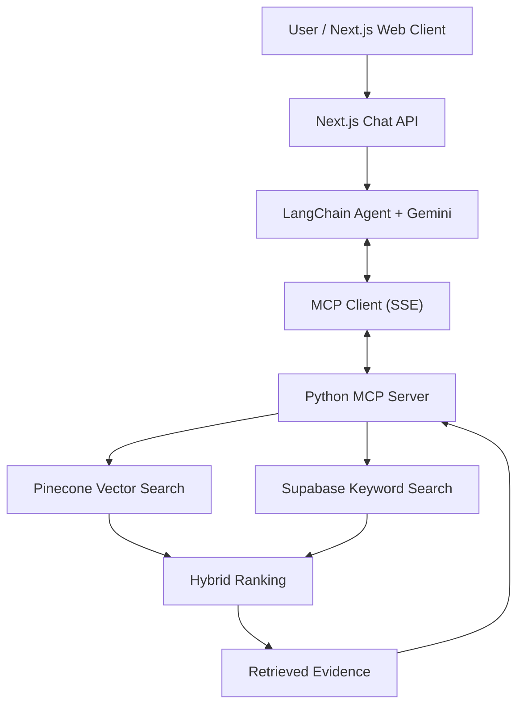
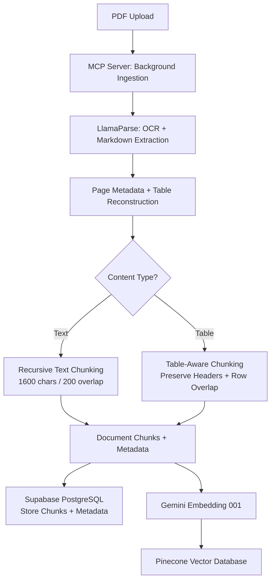

# RAG Chatbot with MCP Server

**Document question-answering application built with Next.js, Python, Model Context Protocol (MCP), and Retrieval-Augmented Generation (RAG).**

This internship project explores how users can upload PDF documents, manage separate chatbot knowledge bases, and ask questions grounded in retrieved document content.

> **Portfolio status:** Documentation in progress. Screenshots, architecture diagrams, and a sanitized demonstration will be added after review for permission to publish.

<!-- Add an approved, redacted screenshot here later:

-->

## Overview

Finding answers across multiple PDF documents can be time-consuming. This application combines document ingestion, vector retrieval, and an LLM-based chat interface to help users locate relevant information through natural-language questions.

The repository contains two main applications: a Next.js web client and a Python MCP server.

## Key Features

- **Multiple chatbots:** Create and manage bots with separate knowledge bases.
- **PDF ingestion:** Parse PDF files using LlamaParse, split extracted content into chunks, and generate embeddings.
- **Hybrid retrieval:** Combine Pinecone vector similarity with Supabase keyword search and weighted ranking.
- **Document management:** Maintain document metadata and chunks with Supabase (PostgreSQL).
- **Web interface:** Chat, upload documents, and manage bots from the Next.js client.
- **MCP integration:** Connect a LangChain tool-calling agent to `query_knowledge_base` and `check_available_doc_years` through the Python MCP server.
- **Streaming chat:** Stream tool-status updates and model output, with chat history and token-usage tracking.
- **Year-aware queries:** Check available document years and filter retrieval using Thai Buddhist Era years.

## Screenshots & Demo

Screenshots will be added after removing internal information and confirming publication permission.

Suggested examples: chatbot interface, PDF upload, bot management, and an anonymized question-and-answer interaction.


## System Architecture



The diagram shows the main components involved in document retrieval. The agent uses retrieved evidence to generate responses, which are streamed back to the web client.


## RAG Workflow


### Document Ingestion Pipeline



**Pipeline explanation**

1. **PDF Parsing:** Extract text and tables using LlamaParse with high-resolution OCR and Markdown output.
2. **Page Processing:** Preserve page numbers, document years, section information, and table context.
3. **Hybrid Chunking:** Apply recursive splitting for text and table-aware splitting for structured data.
4. **Metadata Storage:** Save document chunks and metadata in Supabase (PostgreSQL).
5. **Vector Indexing:** Generate embeddings using Gemini Embedding 001 and store vectors in Pinecone.


**Question answering**

1. The Next.js API checks authentication, bot permissions, and token allowance.
2. The agent loads up to six recent chat messages and receives the user question.
3. The agent can call `check_available_doc_years` or `query_knowledge_base` via MCP. The prompt instructs it to clarify ambiguous years.
4. The backend retrieves and ranks relevant document content from Pinecone and Supabase.
5. Gemini generates a streamed response; the prompt requests document filename/page citations when context is available.
6. The application saves chat history and records token usage (or an estimate if provider usage is unavailable).

> Tool use and citations are prompted behaviors, not guarantees of factual correctness. Test representative questions before making performance claims.

## My Contribution

*To complete before publishing:* Describe your individual responsibilities, including which ingestion, retrieval, MCP, API, and UI components you personally implemented or improved. Distinguish individual work from team work.

## Engineering Challenges

*To complete with verified examples:* Document a concrete problem, the change you made, and how you checked the result. Possible topics to confirm against the project history include PDF parsing, chunking, retrieval relevance, and document metadata handling.

## Results & Limitations

No benchmark or accuracy metrics are claimed here. Add reproducible tests, representative anonymized examples, and known limitations when available.

## Tech Stack

| Area | Technology |
| --- | --- |
| Web client | Next.js, TypeScript, Tailwind CSS |
| Python backend | Python, Starlette, MCP SDK |
| Document parsing | LlamaParse |
| Embeddings | Google `gemini-embedding-001` |
| Chat model / orchestration | Gemini `gemini-3-flash-preview`, LangChain tool-calling agent |
| Retrieval | Pinecone vector search + Supabase keyword search |
| Streaming / transport | Next.js ReadableStream, MCP over SSE |
| Vector database | Pinecone |
| Data storage | Supabase (PostgreSQL) |

> Confirm dependency versions against `package.json` and `requirements.txt` before publishing.

## Repository Structure

```text
.
├── README.md
├── mcp-server-python/
│   ├── .env.example
│   ├── .gitignore
│   ├── requirements.txt
│   └── server.py
└── web-client/
    ├── .env.example
    ├── .gitignore
    ├── app/
    ├── components/
    ├── content/
    ├── public/
    └── package.json
```

The `.env` files, local virtual environments, and uploaded documents are not part of the public-facing project structure.

## Getting Started

### Requirements

- Node.js and npm (check the current Next.js version for its minimum Node.js requirement)
- Python 3.12 or a version compatible with `requirements.txt`
- Access to the configured Google, LlamaCloud, Pinecone, and Supabase services
- Authentication provider configuration where required

### 1. Configure the Python server

From the repository root:

```bash
cd mcp-server-python
python -m venv venv
```

Activate the environment:

```powershell
# Windows PowerShell
.\venv\Scripts\Activate.ps1
```

Or on macOS/Linux:

```bash
source venv/bin/activate
```

Then install and run:

```bash
pip install -r requirements.txt
cp .env.example .env  # On Windows, copy the file manually or use Copy-Item
python server.py
```

Populate `.env` with your own credentials before starting the server. The original README documents the backend at `http://localhost:8000`.

### 2. Configure the web client

Open another terminal at the repository root:

```bash
cd web-client
npm install
npm run dev
```

Copy `web-client/.env.example` to `web-client/.env.local` and fill in the required values **before** running the app. The original README documents the web client at `http://localhost:3000`.

> The repository currently shows both `package-lock.json` and `pnpm-lock.yaml`; select and verify one package manager before publishing final setup instructions.

## Security & Publication

- Do not commit real `.env` files, API keys, Supabase service-role credentials, uploaded internal documents, or personal data.
- Use mock documents and anonymized screenshots for demonstrations.
- Confirm ownership and publication permission for internship code and materials before making the repository public.
- Check committed source and Git history for embedded secrets before publication; `.gitignore` alone is not a historical secret scan.

## Next Steps

- Add approved screenshots and a short demo.
- Verify the end-to-end architecture and retrieval behavior against the current implementation.
- Document individual contributions and technical decisions.
- Add repeatable tests or anonymized evaluation examples.
